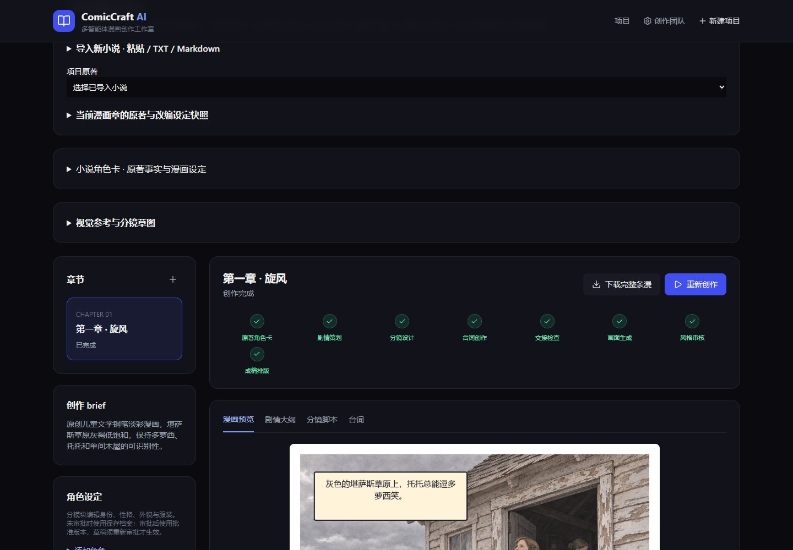
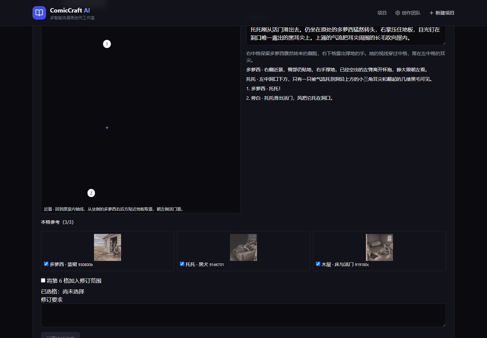
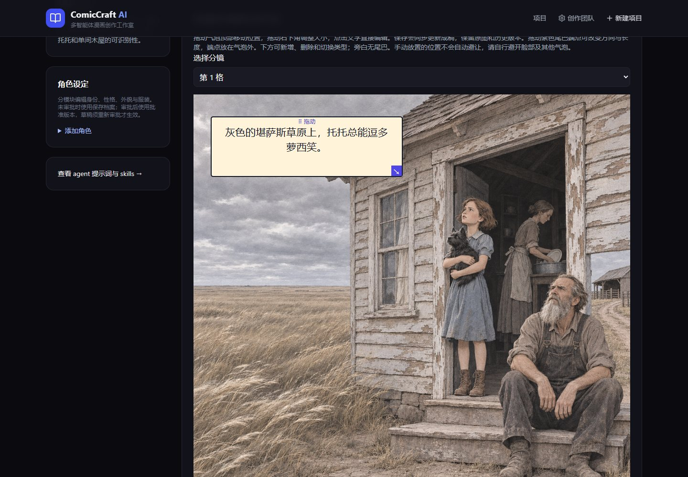
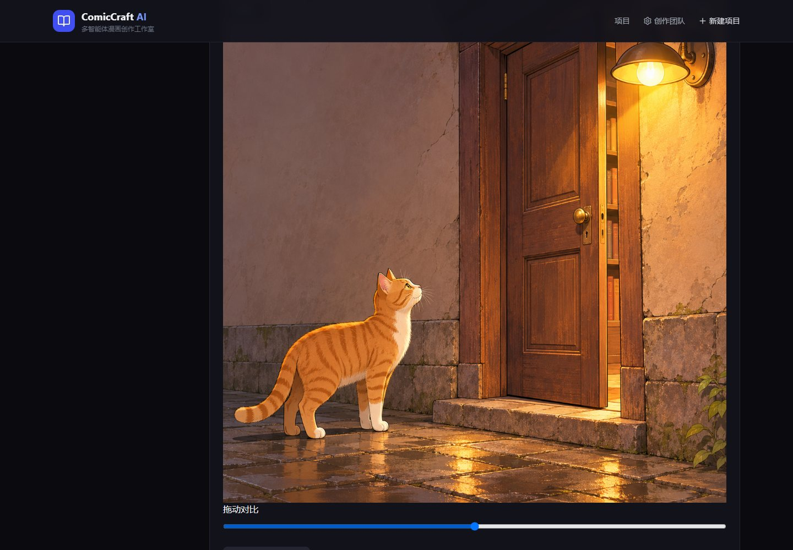
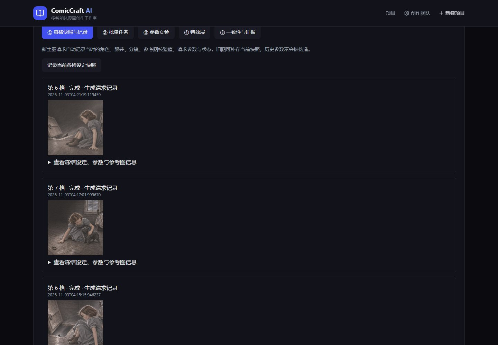
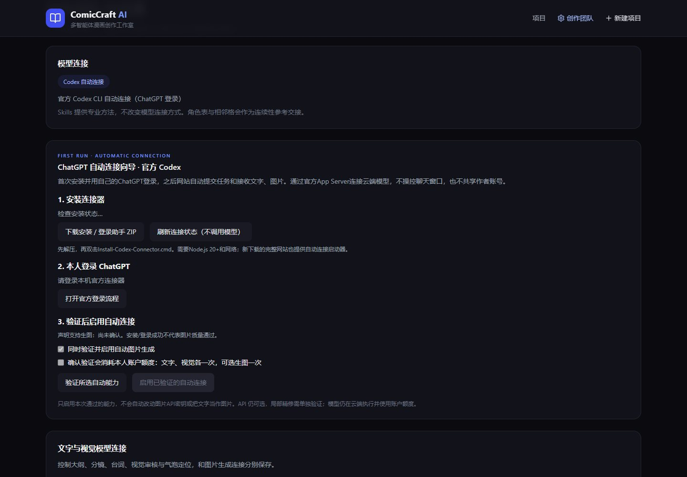

# ComicCraft AI · An editable comic creation workspace

[](https://seigi-91.github.io/comiccraft-ai/#promo-video)

**[Play the promo online](https://seigi-91.github.io/comiccraft-ai/#promo-video)** · [Watch the project demo (MP4)](https://github.com/Seigi-91/comiccraft-ai/releases/download/demo-2026-11/ComicCraft-AI-Promo.mp4) · [Download the editable HyperFrames project](https://github.com/Seigi-91/comiccraft-ai/releases/download/demo-2026-11/ComicCraft-AI-Promo-Editable.zip)

[简体中文](README.md) · **English**

[](https://github.com/Seigi-91/comiccraft-ai/actions/workflows/ci.yml)
[](LICENSE)

Turn a story into panels you can keep editing: scripts, character outfits, dialogue bubbles, masked repairs and chapter versions. Built with React, FastAPI, LangGraph, SQLite and Pillow.

[Showcase](https://seigi-91.github.io/comiccraft-ai/) · [Windows installation](docs/INSTALL.md) · [User guide](docs/USER_GUIDE.md) · [Architecture](docs/ARCHITECTURE.md)

## Feature walkthrough

Screenshots from the running application. Open an image at full size, or try the interactive editor from the featured chapter.

[Full showcase](https://seigi-91.github.io/comiccraft-ai/#workspace-preview) · [Try the balloon editor](https://seigi-91.github.io/comiccraft-ai/demo.html?sample=fifty-five)

| Creation | Planning and production |
|---|---|
| **Novel import and adaptation**<br>[](docs/images/feature-novel.jpg)<br>Import a source, preview excerpts, and set the chapter’s panel count and required facts. | **Visual references and storyboard draft**<br>[](docs/images/feature-planning.jpg)<br>Assign references per panel and preview the action, inset shots, and balloon positions. |
| **In-panel balloon editing**<br>[](docs/images/feature-bubbles.jpg)<br>Move, resize, and edit speech balloons, adjust the tails, then recompose the comic. | **Masked panel repair**<br>[](docs/images/feature-repair.jpg)<br>Mark a region and compare the repair candidate against the original before adopting it. |
| **Production workbench**<br>[](docs/images/feature-production.jpg)<br>Inspect panel generation records, batch jobs, parameter experiments, and effects layers. | **Creative team and model settings**<br>[](docs/images/feature-studio.jpg)<br>Inspect agent roles and knowledge cards, and manage text, vision, and image connections. |

## Featured comic · We Need To Talk About Fifty-Five

A Chinese adaptation of the opening installment of qntm’s SCP Wiki serial. The finished chapter uses uneven panel sizes, inset close-ups, and dialogue placed inside the panels.

**[Read the full comic](https://seigi-91.github.io/comiccraft-ai/web-novel.html)** · **[Edit a balloon on artwork from this chapter](https://seigi-91.github.io/comiccraft-ai/demo.html?sample=fifty-five)** · [View full application screenshots](https://seigi-91.github.io/comiccraft-ai/#workspace-preview)

[](https://seigi-91.github.io/comiccraft-ai/web-novel.html)

## What makes this useful

- Six role-specific agents coordinate planning, storyboards, dialogue, artwork, review and layout.
- Edit the outline, panel descriptions and dialogue rather than restarting the whole chapter.
- Move/resize bubbles, edit their text, drag tail tips, and switch speech/thought/narration.
- Select a damaged region for repair, compare the result and explicitly adopt it. Compositing retains original source-panel pixels outside the mask.
- Keep character profiles and outfits, attach references, inspect per-panel request snapshots and restore chapter versions.
- Configure text/vision and image providers independently. Use your own API services, the official Codex connector, or a combination.

These features support control and review; they do not guarantee visual consistency or make the project unique among comic tools.

## Choose how models run

Open **Creative Team & Settings** (the application UI currently uses Chinese labels: **创作团队与设置**).

| Setup | Text & vision panel | Image panel | What you do |
|---|---|---|---|
| Official Codex connector | Codex | Codex | Sign in to ChatGPT, verify capabilities, and enable automatic calls |
| Automated providers | API | API | Supply separate base URLs, model names and your own keys |
| Mixed | Either | Either | Use an API for writing and ChatGPT for images, or the reverse |

Text/vision uses OpenAI-compatible `/chat/completions`; visual review needs an image-capable model. Image generation uses `/images/generations`, reference-based generation uses multipart `/images/edits`. Masked editing also needs an editing-capable service. Native vendor-specific protocols need separate adapters.

Keys stay in the backend computer's `.env` and are not returned by the configuration endpoint. Settings writes are restricted to local access. You can keep an existing key by leaving its field empty, or explicitly clear it. Saving settings does **not** send a paid test or verify your provider's quota.

**Manual generation handoffs are retired in v2.5.1.** Existing tasks can migrate to an automatic provider; editorial approval is still available. This project does not extract session credentials or provide model access/credits. The GitHub Pages demo uses pre-generated artwork and makes no AI calls. The complete app runs locally.

## Run locally

Requirements: Python 3.11+, Node.js 20+, Git. No GPU is required by the orchestration/editor itself; external or locally hosted models have their own requirements.

Windows one-click bootstrap: download the [installer ZIP](https://github.com/Seigi-91/comiccraft-ai/releases/download/v2.5.1/ComicCraft-AI-Windows-Installer.zip), extract it, then run `Install-ComicCraft-Auto.cmd` for the official connector setup, or `Install-ComicCraft.cmd` for the website only. It downloads tagged source and can install missing Python/Node through winget. Internet and any OS permission prompts still apply. It preserves existing local work. [Details and limitations](docs/INSTALL.md).

Or use Git on Windows:

```powershell
git clone https://github.com/Seigi-91/comiccraft-ai.git
cd comiccraft-ai
powershell -ExecutionPolicy Bypass -File .\start.ps1
```

Open **http://127.0.0.1:8000**. The script creates a venv, copies `.env.example` if needed, installs dependencies and builds the frontend.

macOS / Linux:

```bash
git clone https://github.com/Seigi-91/comiccraft-ai.git
cd comiccraft-ai
python3 -m venv .venv
source .venv/bin/activate
python -m pip install -e '.[dev]'
cp .env.example .env # only for a fresh installation; preserve an existing .env
npm --prefix frontend ci
npm --prefix frontend run build
python -m uvicorn app.main:app --host 127.0.0.1 --port 8000
```

Install a Chinese-capable font, such as Noto Sans CJK, and set `COMIC_FONT_PATH` if needed. A fresh install starts with an empty database. Click the home screen’s sample-import button to load an editable six-panel example without model calls. Re-import opens it without overwriting edits. Environment diagnostics are available there too.

## Architecture

| Layer | Implementation |
|---|---|
| Interface and API | React, TypeScript, and Vite power the workspace. FastAPI and Pydantic handle APIs and structured output validation |
| Orchestration and storage | LangGraph coordinates story, storyboard, dialogue, illustration, visual review, and lettering. SQLAlchemy and SQLite store task state, assets, versions, and generation records |
| Model connections | The local official Codex App Server calls cloud models using your own ChatGPT login. Compatible APIs can be configured for text and vision, image generation, and masked editing |
| Creative knowledge | Role skills and local lexical retrieval add relevant guidance to prompts. Retrieval ranks English terms and Chinese character bigrams within each role and records card IDs and hashes |
| Incremental revision | Each finished panel is checkpointed. Request fingerprints track prompts, reference content, and provider configuration. Review reuse depends on unchanged visual evidence |
| Image processing and lettering | Pillow composes the artwork, editable speech balloons, and effects. Masked repair composites candidate pixels within the selected region and preserves original pixels outside it |

[Architecture](docs/ARCHITECTURE.md) · [Official connector](docs/CODEX_CONNECTION.md) · [Knowledge cards](knowledge/README.md) · [Budgets and recovery](docs/PRODUCTION_SAFETY.md)

## Limits and validation

- This is an early local-first app, **not a public multi-user SaaS**. There is no login, tenant isolation or per-user secret vault. Keep the full backend on loopback; set `ENABLE_LOCAL_SETTINGS=false` for administrator-managed remote installations and add appropriate security before exposing it.
- Character continuity uses profiles and reference images, not a newly trained consistency model. Face/hand/prop protection depends on visual-model judgment and may miss objects.
- ChatGPT style/size instructions are prompt constraints, not guaranteed inference seeds or sampling steps.
- Batch processing uses a local single-process scheduler. It is not a distributed production queue.
- Protocol tests use mock HTTP and deterministic handoff data. They do not prove image quality, real provider availability or successful paid generation.
- There is no full vector RAG; recent outlines and character records supply context.

```bash
python -m pip install -e '.[dev]'
python -m pytest -q
npm --prefix frontend ci
npm --prefix frontend run build
```

## Learn more / contribute

Most detailed guides are currently in Chinese: [model connections](docs/MODEL_CONNECTIONS.md), [setup](docs/SETUP.md), [user guide](docs/USER_GUIDE.md), [architecture](docs/ARCHITECTURE.md), [comparison](docs/COMPETITIVE_ANALYSIS.md), [contributing](CONTRIBUTING.md).

Use [issue templates](https://github.com/Seigi-91/comiccraft-ai/issues/new/choose) for bugs, provider compatibility or feature proposals. Include redacted reproduction steps; never attach API keys or private projects. Small contributions to documentation, reproducible samples and compatibility reports are welcome. English UI localization and real provider verification are still open work.

If the workflow helps you, a voluntary GitHub Star makes it easier to find again. Successful installs and specific feedback are just as valuable.

## License

Original code/docs: [MIT](LICENSE). Third-party skills, fonts, music and components retain their own licenses; see [THIRD_PARTY_NOTICES](THIRD_PARTY_NOTICES.md). See each demo’s attribution for source text and artwork details.

## Creative skills and knowledge

Role skills define the handoff and checks for each stage. Local retrieval adds relevant cases and source-backed guidance. The workflow separates source facts from visual adaptation choices, preserves narrative beats, supports asymmetric panels and inset shots, and reserves in-panel space for separate speech balloons. Reference images guide identity and spatial structure while the current shot controls action and state. Review distinguishes continuity errors from editorial choices.

[Role skills](skills/) · [Knowledge and sources](knowledge/README.md) · [Workflow validation](benchmarks/VISUAL_WORKFLOW_VALIDATION.md)

## Novel adaptation and storyboard review

1. Open **小说改编 · 导入原著**, import TXT or Markdown, and select the excerpt, fidelity mode, panel count, and required facts. Import and chapter creation make no model calls.
2. Generate source-grounded character cards and review the outline. The workflow then prepares the storyboard and dialogue and pauses before image generation.
3. In **视觉参考与分镜草图**, lock character, scene, and prop references and attach up to three per panel. Review the action, inset shots, dialogue, and balloon positions, then confirm rendering.
4. Revise selected panels or adjust lettering separately. Later chapters from the same imported novel can carry over character settings and the preceding completed chapter’s final shot.

This workflow is available on `main`. The linked v2.5.1 installer downloads the tagged release. In the live *Wizard of Oz* trial, only the two selected panels changed. A subsequent lettering save took about 1.9 seconds and added no model calls. See the [validation record](benchmarks/VISUAL_WORKFLOW_VALIDATION.md).

Original text and provenance stay separate from existing chapters. Bubble editing, masked repair, production tools and chapter rollback remain available. Each task retains its source/settings snapshot. Limits: 300,000 characters per import, 2MB files, 8,000 characters per excerpt and 200 excerpts. This is a per-excerpt workflow, not automatic whole-book adaptation or a guarantee of fidelity. [Detailed guide](docs/NOVEL_ADAPTATION.md).
