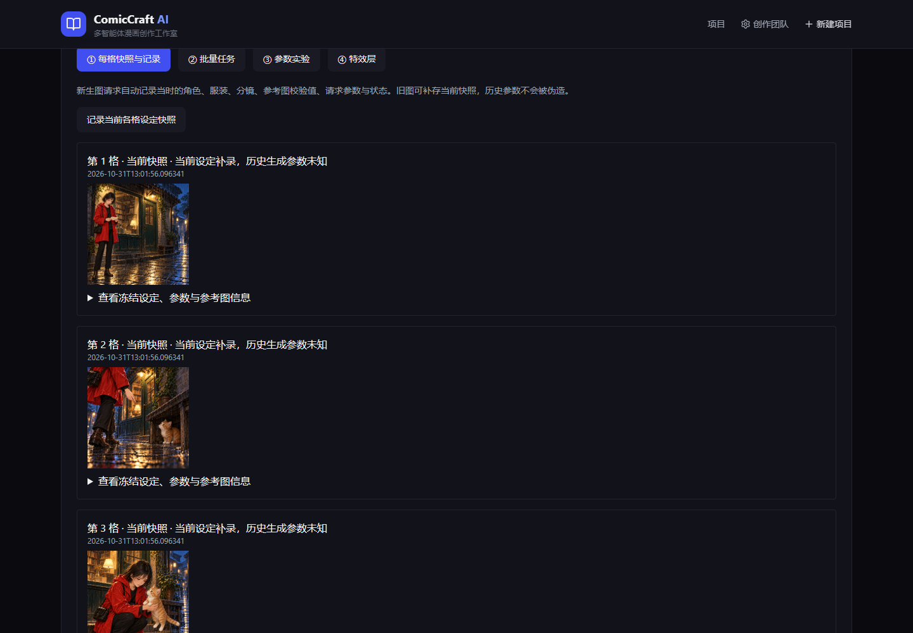

# ComicCraft AI · 可编辑、可回退的漫画创作工作室

**简体中文** · [English](README.en.md)

[](https://github.com/Seigi-91/comiccraft-ai/actions/workflows/ci.yml)
[](LICENSE)

从创作灵感、角色档案和分镜，到连贯漫画、可编辑气泡与局部精修。基于 **React + FastAPI + LangGraph + SQLite + Pillow**，面向本机创作和可审阅的人机协作。

**公开仓库提供源码、文档和成稿供浏览；完整创作网站需要在本机运行。** 默认使用官方 ChatGPT 自动连接器；也可以配置自己的模型 API。无需 API key 即可启动网站；模型创作需要你已有的 ChatGPT 或实际可用的模型服务。

[公开演示首页](https://seigi-91.github.io/comiccraft-ai/) · [Windows 安装](docs/INSTALL.md) · [操作手册](docs/USER_GUIDE.md) · [架构与接口](docs/ARCHITECTURE.md)

## 成稿预览 ·《我们得谈谈五十五号》

改编自 qntm 在 SCP Wiki 连载的《反模因部不存在》开篇。完整成稿展示不等分主格、过渡窄格、嵌入特写和画内对白。

**[阅读完整条漫](https://seigi-91.github.io/comiccraft-ai/web-novel.html)** · **[用本章原画试改气泡](https://seigi-91.github.io/comiccraft-ai/demo.html?sample=fifty-five)** · [查看完整应用界面截图](https://seigi-91.github.io/comiccraft-ai/#workspace-preview)

[](https://seigi-91.github.io/comiccraft-ai/web-novel.html)

## 已实现

| 能力 | 内容 |
|---|---|
| 六个 Agent | 剧情策划、分镜、台词、画面设计、视觉审核、排版；明确职责和结构化输出 |
| 小说改编 | 粘贴/TXT/Markdown、章节分段、忠实/适度/自由改编、来源快照、原著角色卡、大纲与分镜草图分阶段审阅 |
| 视觉参考 | 角色、场景、道具参考可锁定版本、逐格绑定并跨章节复用 |
| 创作编辑 | 大纲、分镜、台词表单编辑；下游失效提示与阶段继续 |
| 角色档案 | 身份、性格、外貌、背景、关系、语言风格；多个服装方案切换 |
| 人物连续性 | 向生图与审核传递角色表、开场/前格参考；失败格修订 |
| 漫画气泡 | 画面中拖动、缩放、改字、字号、尾尖方向长度、增删、类型切换 |
| 视觉排版 | 查看实际分镜，识别脸、手、道具保护框，检查气泡越界与交叠 |
| 局部精修 | 圈选多块蒙版、自动图像编辑、对比滑块、确认采用 |
| 像素保护 | 精修候选只采用蒙版内像素，未选原始分镜像素保持不变 |
| 生产工作台 | 每格设定快照与请求记录、章节批次、实验候选对比、非破坏特效层 |
| 版本管理 | 修改前备份整个章节，恢复台词、图片、气泡和特效状态 |



## Windows 一键安装

下载 [Windows 安装启动器 ZIP](https://github.com/Seigi-91/comiccraft-ai/releases/download/v2.5.1/ComicCraft-AI-Windows-Installer.zip)，解压后双击 `Install-ComicCraft-Auto.cmd`，安装官方连接器并完成本人登录；只安装网站可使用 `Install-ComicCraft.cmd`。需要网络；缺少 Python/Node 时通过 winget 安装，有系统权限要求时仍需自行确认。完整流程、升级与验证边界见 [INSTALL](docs/INSTALL.md)。

启动后首页可一键导入《雨夜留灯》完整可编辑示例，**不调用模型**；重复导入会打开旧示例，不覆盖修改。首页还提供环境诊断。

## 5 分钟启动（依赖下载时间另计）

需要 **Python 3.11+、Node.js 20+、Git**，建议先使用 Windows。

```powershell
git clone https://github.com/Seigi-91/comiccraft-ai.git
cd comiccraft-ai
powershell -ExecutionPolicy Bypass -File .\start.ps1
```

浏览器打开 **http://127.0.0.1:8000**。脚本创建虚拟环境、复制 `.env.example`、安装依赖并构建前端。

手动安装及 macOS/Linux 说明见 [SETUP](docs/SETUP.md)。从公开仓库安装后是新数据库；首页可显式导入预生成示例，保留原始来源标记，不恢复作者电脑中的私有项目记录。

## 文字和图片，分别选择自己的模型

在「创作团队与设置」中分别保存「文字与视觉模型连接」和「图片模型连接」。密钥各自独立，留空保留已有值，也可以明确清除；不会在配置读取接口回显。

| 使用方式 | 文字/视觉设置 | 图片设置 |
|---|---|---|
| 官方 Codex 自动连接 | ChatGPT 登录的官方 CLI | 内置生图需实测，或独立选 API |
| 自动生成 | API 地址 + 文字/视觉模型 + Key | API 地址 + 图片模型 + Key |
| 混合创作 | API 或 ChatGPT | 独立选择 API 或 ChatGPT |

文字采用 OpenAI 兼容 `/chat/completions`，视觉模型还须支持图片输入；图片使用 `/images/generations`，有参考图或蒙版时需支持 `/images/edits`。不是每家供应商的私有协议都能直接填入。保存配置不会产生付费测试，也不代表已验证账户额度。

[完整模型连接说明](docs/MODEL_CONNECTIONS.md) · [能力与实际验证状态](docs/PROVIDERS.md)。免安装体验只使用预生成图片，不演示 AI 生成，刷新会重置修改；完整创作仍在本机应用中进行。

## 技术架构

| 层次 | 实现 |
|---|---|
| 交互与 API | React、TypeScript、Vite 提供工作台。FastAPI 和 Pydantic 处理接口与结构化输出校验 |
| 编排与存储 | LangGraph 串联剧情、分镜、台词、绘图、视觉审核和排版。SQLAlchemy 与 SQLite 保存任务、版本、引用和生成记录 |
| 模型连接 | 本机官方 Codex App Server 使用本人 ChatGPT 登录调用云端模型，也可接入兼容 API。文字与视觉、图片生成、局部编辑分别按能力配置 |
| 创作知识 | 角色 skill 与本地词法检索共同进入提示词。英文词项与中文二字片段按角色过滤、加权排序，任务记录使用的知识卡及指纹 |
| 增量修订 | 每格生成后保存进度。请求指纹包含提示词、参考图内容和模型连接，视觉复审按实际证据复用。定向重绘可保留范围外的原画 |
| 图像处理与排字 | Pillow 负责独立气泡、尾巴、特效和条漫合成。局部精修只合入蒙版内像素，未选区保留原图像素 |

[架构与接口](docs/ARCHITECTURE.md) · [官方连接器](docs/CODEX_CONNECTION.md) · [知识库](knowledge/README.md) · [生成预算与恢复](docs/PRODUCTION_SAFETY.md)

## 创作规则与知识库

角色 skills 负责各阶段的必做检查，知识库按角色和当前任务检索适用案例。小说先提取角色和原著事实，再安排完整的因果节拍。分镜可用不等分主格、窄过渡格和嵌入特写，生图前预留说话人各自的气泡空间。绘图保留角色身份和场景结构，动作、服装与道具状态以当前镜头为准。复审区分影响剧情的错误和可由编辑确认的小偏差，排字保持在画格内。

[角色 skills](skills/) · [知识卡与来源](knowledge/README.md) · [工作流验证](benchmarks/VISUAL_WORKFLOW_VALIDATION.md)

## 小说改编入口

1. 打开「小说改编 · 导入原著」，保存原文并选择片段、改编方式、1–24 格和必须保留的事实。导入和建章不会调用模型。
2. 开始生成后先提取角色卡，区分原著事实与漫画造型。审阅大纲后生成分镜和对白。
3. 在「视觉参考与分镜草图」锁定角色、场景或道具参考，每格最多选三张。可调整动作、嵌入小格、对白及其位置，确认后才开始绘图。
4. 成稿后可选多格定向修订。移动气泡时直接重新排版。同一小说后续章节可以带入已完成前章的角色设定和末镜资料。

上述工作流已合入 `main`。上方 v2.5.1 安装包对应已发布版本。实测在《绿野仙踪》第一章仅替换了指定的两格，其余六格保留原图。单独移动气泡的保存耗时约 1.9 秒，模型调用记录未增加。详见[验证记录](benchmarks/VISUAL_WORKFLOW_VALIDATION.md)。

支持单次30万字符、2MB文本文件，长章分为最多8000字符的片段。当前按片段逐章改编，尚非整本长篇一键自动制作。[完整小说改编说明](docs/NOVEL_ADAPTATION.md)

## 测试

```powershell
.\.venv\Scripts\python.exe -m pip install -e ".[dev]"
.\.venv\Scripts\python.exe -m pytest -q
npm.cmd --prefix frontend ci
npm.cmd --prefix frontend run build
```

当前包含 64 项后端测试；GitHub Actions 分别运行 Python 测试及前端构建。测试使用隔离数据库、确定性回填与模拟 HTTP，不声称验证了真实付费模型的质量。

## 目录与文档

- `app/`：API、Agent、LangGraph、模型适配、排版和数据持久化。
- `frontend/`：React 编辑器、角色档案、精修与生产工作台。
- `skills/`：项目原创规则及保留许可、固定版本的上游方法。
- `tests/`：流程、版本、像素保护、批次和特效测试。
- `outputs/rain-night-light/`：示例漫画与修订对比。
- `videos/ComicCraft-AI-demo-editable/`：HyperFrames 可编辑视频工程。

详见 [用户手册](docs/USER_GUIDE.md)、[安装配置](docs/SETUP.md)、[架构](docs/ARCHITECTURE.md)、[贡献指南](CONTRIBUTING.md)、[安全说明](SECURITY.md)、[第三方许可](THIRD_PARTY_NOTICES.md)。

## 许可

项目原创代码与文档采用 [MIT](LICENSE)。上游技能、字体、音乐、JavaScript 等第三方资源保留各自许可，**不因根目录 MIT 而改换许可**。示例漫画为 AI 辅助创作，原著与素材的来源和许可见各作品说明；第三方素材详见 [许可清单](THIRD_PARTY_NOTICES.md)。

## 继续参与

如果编辑流程对你有帮助，欢迎点 Star 留作收藏。安装反馈、脱敏的服务兼容报告和文档改进同样有价值。

[同类项目调研与优缺点](docs/COMPETITIVE_ANALYSIS.md) · [下一步路线图](docs/ROADMAP.md) · [服务兼容证据](docs/PROVIDERS.md) · [问题与需求反馈](https://github.com/Seigi-91/comiccraft-ai/issues/new/choose)
