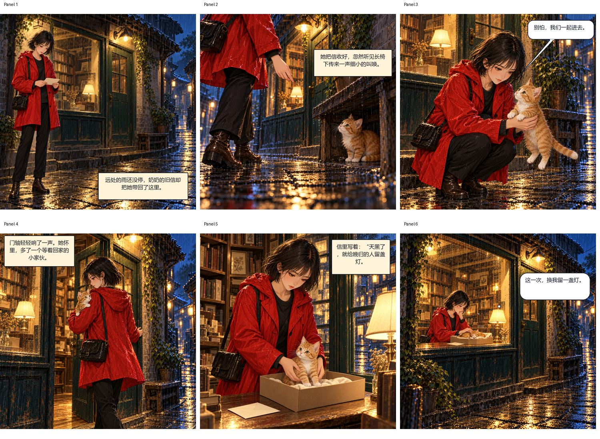
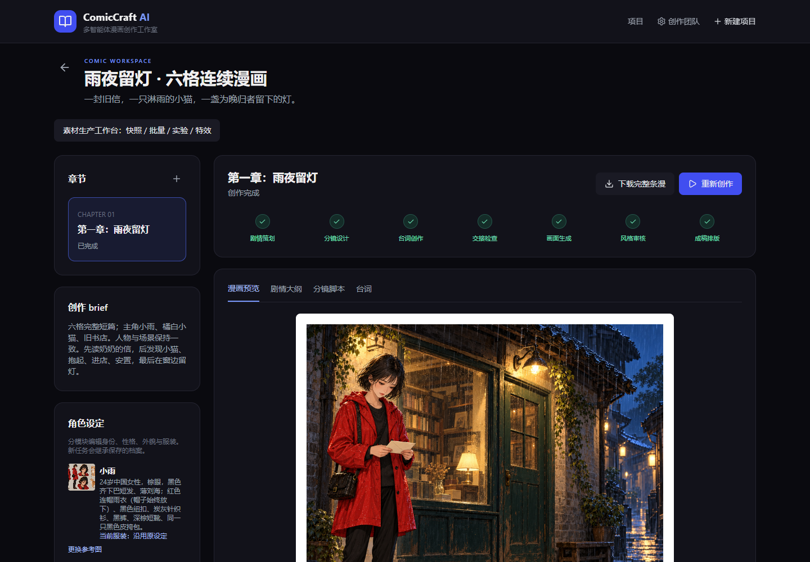
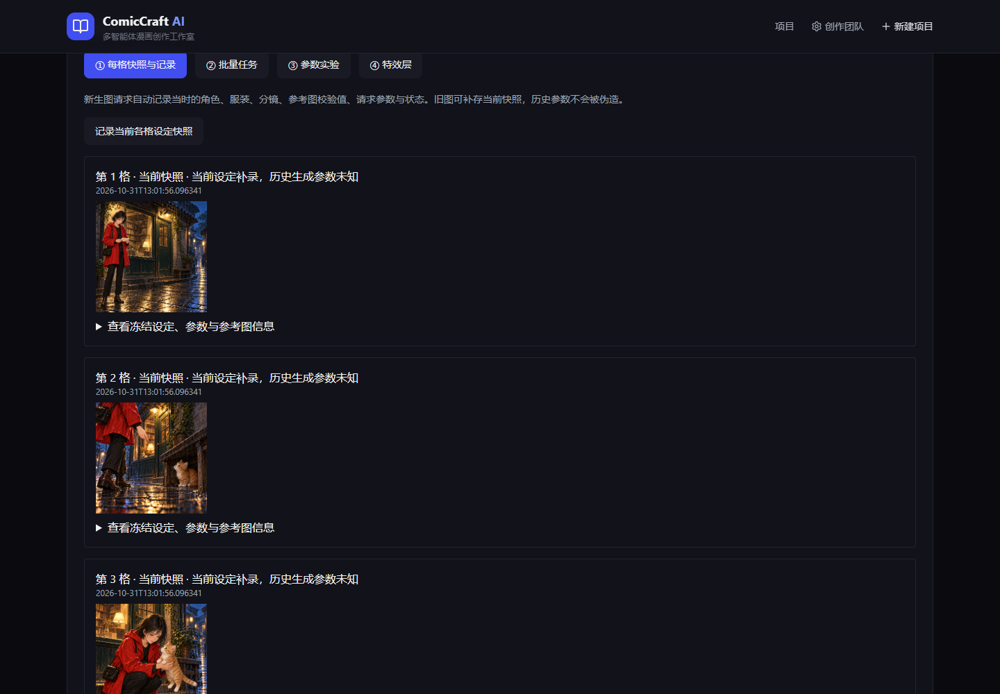

# ComicCraft AI · 多智能体漫画创作工作室

[](https://github.com/Seigi-91/comiccraft-ai/actions/workflows/ci.yml)
[](LICENSE)

从创作灵感、角色档案和分镜，到连贯漫画、可编辑气泡与局部精修。基于 **React + FastAPI + LangGraph + SQLite + Pillow**，面向本机创作和可审阅的人机协作。

**公开仓库提供源码、文档和成稿供浏览；完整创作网站需要在本机运行。** 默认使用 ChatGPT 协作回填，不是自动控制桌面客户端，也不是免费代理模型 API。无需 API key 即可启动网站；模型创作需要你已有的 ChatGPT 或实际可用的模型服务。

[在线静态展示](https://seigi-91.github.io/comiccraft-ai/) · [功能与完整操作手册](docs/USER_GUIDE.md) · [安装与配置](docs/SETUP.md) · [架构与接口](docs/ARCHITECTURE.md) · [演示与下载](https://github.com/Seigi-91/comiccraft-ai/releases)

## 看看成稿

示例《雨夜留灯》：少女在雨夜旧书店发现小猫，带它进门，留下一盏灯。



[完整手部精修成稿 PNG](outputs/rain-night-light/雨夜留灯-手部精修成稿.png) · [手部精修前后对比](outputs/rain-night-light/雨夜留灯-手部精修前后对比.jpg)



## 已实现

| 能力 | 内容 |
|---|---|
| 六个 Agent | 剧情策划、分镜、台词、画面设计、视觉审核、排版；明确职责和结构化输出 |
| 创作编辑 | 大纲、分镜、台词表单编辑；下游失效提示与阶段继续 |
| 角色档案 | 身份、性格、外貌、背景、关系、语言风格；多个服装方案切换 |
| 人物连续性 | 向生图与审核传递角色表、开场/前格参考；失败格修订 |
| 漫画气泡 | 画面中拖动、缩放、改字、字号、尾尖方向长度、增删、类型切换 |
| 视觉排版 | 查看实际分镜，识别脸、手、道具保护框，检查气泡越界与交叠 |
| 局部精修 | 圈选多块蒙版、ChatGPT 回填或编辑 API、对比滑块、确认采用 |
| 像素保护 | 精修候选只采用蒙版内像素，未选原始分镜像素保持不变 |
| 生产工作台 | 每格设定快照与请求记录、章节批次、实验候选对比、非破坏特效层 |
| 版本管理 | 修改前备份整个章节，恢复台词、图片、气泡和特效状态 |



## 5 分钟启动（依赖下载时间另计）

需要 **Python 3.11+、Node.js 20+、Git**，建议先使用 Windows。

```powershell
git clone https://github.com/Seigi-91/comiccraft-ai.git
cd comiccraft-ai
powershell -ExecutionPolicy Bypass -File .\start.ps1
```

浏览器打开 **http://127.0.0.1:8000**。脚本创建虚拟环境、复制 `.env.example`、安装依赖并构建前端。

手动安装及 macOS/Linux 说明见 [SETUP](docs/SETUP.md)。从公开仓库安装后是新数据库；示例漫画在 `outputs/`，不会自动恢复作者电脑中的项目记录。

## ChatGPT 协作如何工作

1. 创建项目、角色和章节，点击生成。
2. 网站给出当前 Agent 的完整任务，复制到 ChatGPT；**同时附上任务要求的参考图片**。
3. 将文字 JSON 粘回网站，或上传真实生成的图片。
4. 网站验证结果，LangGraph 继续下一阶段；审核未通过时重绘失败格。
5. 全部通过后本机合成 PNG，台词由排版器绘制，不依赖生图模型画字。

本仓库漫画样例由创作会话中的图像工具生成，再通过同一回填流程导入。该工具没有作为网站后台接口开放。生成质量与角色一致性需要实际查看，不能只依据模型评分。

## 自动接口与边界

- 可配置 OpenAI 兼容文字/视觉/生图 HTTP 服务，以及独立 `/images/edits` 图像编辑服务；密钥只放本机 `.env`。
- 当前 HTTP **生图**适配器不支持参考图，有参考图时明确报错；不要把本地文字模型等同于生图服务。
- ChatGPT 模式中的尺寸和风格是提示词约束，**不是 seed、步数或去噪强度等底层推理参数**。
- 没有完整向量 RAG；当前使用角色资料及最近三章大纲构造上下文。
- 批次是单进程本地调度，暂停/取消不强杀当前项；不提供分布式任务保证。
- 无登录、租户隔离和生产级权限控制。默认只绑定 `127.0.0.1`，不要直接将当前版本开放到公网。
- 气泡保护框依赖视觉判断，可能漏检；手动位置、蒙版接缝和特效遮挡仍需人工检查。

## 测试

```powershell
.\.venv\Scripts\python.exe -m pip install -e ".[dev]"
.\.venv\Scripts\python.exe -m pytest -q
npm.cmd --prefix frontend ci
npm.cmd --prefix frontend run build
```

当前包含 20 项后端测试；GitHub Actions 分别运行 Python 测试及前端构建。测试使用隔离数据库、确定性回填与模拟 HTTP，不声称验证了真实付费模型的质量。

## 目录与文档

- `app/`：API、Agent、LangGraph、模型适配、排版和数据持久化。
- `frontend/`：React 编辑器、角色档案、精修与生产工作台。
- `skills/`：项目原创规则及保留许可、固定版本的上游方法。
- `tests/`：流程、版本、像素保护、批次和特效测试。
- `outputs/rain-night-light/`：示例漫画与修订对比。
- `videos/ComicCraft-AI-demo-editable/`：HyperFrames 可编辑视频工程。

详见 [用户手册](docs/USER_GUIDE.md)、[安装配置](docs/SETUP.md)、[架构](docs/ARCHITECTURE.md)、[贡献指南](CONTRIBUTING.md)、[安全说明](SECURITY.md)、[第三方许可](THIRD_PARTY_NOTICES.md)。

## 许可

项目原创代码与文档采用 [MIT](LICENSE)。上游技能、字体、音乐、JavaScript 等第三方资源保留各自许可，**不因根目录 MIT 而改换许可**。示例漫画为 AI 生成的虚构人物作品，仅作为效果示例提供；第三方素材详见 [许可清单](THIRD_PARTY_NOTICES.md)。
