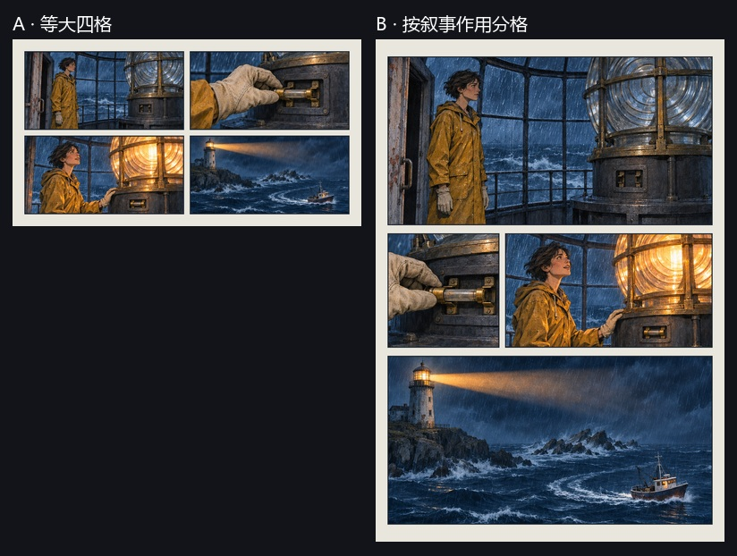

# 漫画原页与灯塔分镜对照

## 原页观察

| 作品 | 在原页上看到什么 | 可以借鉴什么 |
|---|---|---|
| Winsor McCay，《Little Nemo in Slumberland》，1908-11-22 | 开头连续几排近似等格。第 11 格放宽火鸡的旋转动作，第 12 格缩小为从梦中惊醒的独立节拍。 | 等格可先建立节奏，变幅用于突出叙事变化。醒来仍给独立外格。 [国会图书馆目录](https://www.loc.gov/pictures/item/2009616051/) · [原稿扫描](https://tile.loc.gov/storage-services/service/pnp/ppmsca/59700/59752v.jpg) |
| George Herriman，《Krazy Kat》，Officer Pupp 一页 | 第 1 格和第 7 格都保留左侧床铺和睡姿。第 7 格加入门锁方向的动作线，第 8 格才显示惊醒。 | 固定机位和地标，把读者的注意力集中到新增动作及其后果。 [国会图书馆目录](https://www.loc.gov/item/2019636119/) · [原稿扫描](https://tile.loc.gov/storage-services/service/pnp/ppmsca/65000/65006v.jpg) |
| 手塚治虫与酒井七马，《新宝岛》官网样页 | 行车镜头由驾驶者、方向盘扩展到车身与道路，车头和速度线保持运动方向。救狗段依次交代发现、抱起和同乘。 | 变景别仍可接续同一动作。若省略接触或交接会让后续难以理解，应保留那一步。 [官网与作者回顾](https://tezukaosamu.net/en/manga/207.html) · [行车图例](https://tezukaosamu.net/jp/manga/img/m0207/m0207_02.jpg) · [救狗图例](https://tezukaosamu.net/jp/manga/img/m0207/m0207_10.jpg) |

原稿仅供链接查阅。手塚官网讨论了重刊过程，本次观察以官网所展示的图例为准。Cohn 与 Campbell 的空白格编号实验发现跨行长格、错位等会改变参与者选择的阅读路径。项目只据此给默认逐行阅读的自动草稿加检查，实际漫画也受人物、对白和读者习惯影响。 [研究论文](https://doi.org/10.1002/acp.3086)

## 原创实图对照 · 风暴中的灯塔

同一次 GPT 图像生成产出四张原画，依次呈现看守人发现灯灭、装保险丝、灯亮和小船避礁。两版采用同一原画和同一镜头顺序，由项目合成器生成，不加旁白。都缩到 390 像素宽观察，页面高度随版式变化。A 的图去掉了末尾未使用的纸面。

- A 的四格都能读清，版面紧凑，适合四个动作权重接近的情节。
- B 把熄灭的灯、看守人和暴风雨放在全宽开场，保险丝与灯亮共用中间一行，最后让光束、礁石和船的航迹出现在同一个宽格。
- B 初版的保险丝格过高，触发了保留全图的黑底适配。缩短不等宽配对行后，复看窄格仍可见手指、保险丝及接触位置。主镜头和线索的比例需要与原画构图配合。

这是一组同素材的版式对照和视觉验收，样例中的叙事角色和安全区域由人工标注。结果支持保留两种布局策略以及这次配对行调整。尚无读者实验或独立图像质量测量。

## 进入项目流程的变化

1. 分镜先明确因果接续和必要镜头，再分配页面。明确指定的版面角色优先于从景别推断的版面角色。
2. 自动草稿若有明显倒序或长格阻断，回退到逐行版式。已校验的独立插格不参加普通外格读序检查。
3. 绘图允许用同机位做状态对照。缩减重复的构图提示，统一外格和格内子镜头的边界。日期和时间文字由排版阶段处理。
