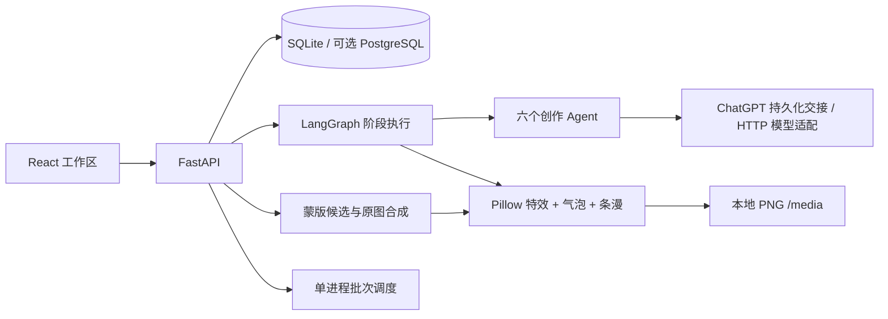

# 架构与接口索引

## 数据

- `Project / Chapter / CharacterProfile / CharacterDetails`：项目、章节和结构化角色资料。
- `Task.result.state`：阶段快照及下一节点；每完成一个阶段保存。
- `Panel`：当前分镜；图片是本站媒体路径。
- `ChapterVersion`：整章快照；图片文件保留，恢复时重新关联。
- `PanelRepair`：蒙版、源图、候选、回填待办和采用状态。
- `ProductionRecord`：不可变输入快照与可更新结果状态。
- `ProductionBatch.items`：持久化批次项、任务引用与状态。
- `data/chatgpt_jobs`：按完整输入摘要标识的回填任务，避免重复消费同一回复。

## 主要 API

全部精确 Schema 以运行中的 `/docs` 为准。

| 前缀 | 功能 |
|---|---|
| `/api/projects` | 项目、章节、角色及服装 |
| `/api/tasks` | 开始、继续、人工修订 |
| `/api/studio` | 模型模式、Agent 规则、待办、上传和回填 |
| `/api/editing/{chapter_id}` | 内容编辑、版本、气泡布局、视觉定位 |
| `/api/repairs` | 局部精修配置、候选、回填与采用 |
| `/api/production` | 快照、记录、批次、实验与特效 |
| `/health` | 后端健康状态 |

## 扩展模型服务

`app/tools/llm_client.py` 适配文字/视觉；`image_gen.py` 适配生成；`services/inpainting.py` 适配编辑。扩展时明确区分模型是否支持参考图、蒙版、尺寸、seed 等参数，不能将不支持的选项仅拼成请求字段来宣称生效。

新增能力应同时添加请求/响应校验、失败状态、输入记录和隔离测试。不要把服务密钥写进前端或生成记录。不要执行上游 skill 附带的安装脚本；运行时只加载已审阅的 Markdown 方法。

## Skill 来源

四个固定版本的上游来源保留其 MIT/Apache 许可；台词诊断和视觉审核的公开版使用项目自编方法，不包含未核实再分发许可的上游包。详情、版本、路径和 SHA 见 `skills/SOURCES.json`。`bubble-placement` 是项目原创视觉定位规则。

## 部署边界

进程内活动任务集合与调度锁只适用于单进程。开启多个 worker 前需要共享锁、幂等约束和真正的持久化队列。公开仓库不是托管服务；当前 API 没有身份验证，不应直接公网部署。
