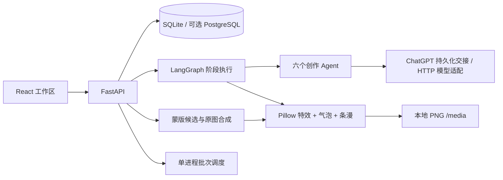

# 架构与接口索引

## 数据

- `Project / Chapter / CharacterProfile / CharacterDetails`：项目、章节和结构化角色资料。
- `Task.result.state`：阶段快照及下一节点；每完成一个阶段保存。
- `Panel`：当前分镜；图片是本站媒体路径。
- `ChapterVersion`：整章快照；图片文件保留，恢复时重新关联。
- `PanelRepair`：蒙版、源图、候选、回填待办和采用状态。
- `ProductionRecord`：不可变输入快照与可更新结果状态。
- `ProductionBatch.items`：持久化批次项、任务引用与状态。
- `data/chatgpt_jobs`：按完整输入摘要标识的回填任务，避免重复消费同一回复。

## 主要 API

全部精确 Schema 以运行中的 `/docs` 为准。

| 前缀 | 功能 |
|---|---|
| `/api/projects` | 项目、章节、角色及服装 |
| `/api/tasks` | 开始、继续、人工修订 |
| `/api/studio` | 模型模式、Agent 规则、待办、上传和回填 |
| `/api/editing/{chapter_id}` | 内容编辑、版本、气泡布局、视觉定位 |
| `/api/repairs` | 局部精修配置、候选、回填与采用 |
| `/api/codex` | 官方CLI安装/登录状态与安装助手下载 |
| `/api/novels` | 小说原文/分段、改编章创建和来源快照 |
| `/api/production` | 快照、记录、批次、实验与特效 |
| `/health` | 后端健康状态 |

## 扩展模型服务

`app/tools/llm_client.py` 适配文字/视觉；`image_gen.py` 适配生成；`services/inpainting.py` 适配编辑。扩展时明确区分模型是否支持参考图、蒙版、尺寸、seed 等参数，不能将不支持的选项仅拼成请求字段来宣称生效。

新增能力应同时添加请求/响应校验、失败状态、输入记录和隔离测试。不要把服务密钥写进前端或生成记录。不要执行上游 skill 附带的安装脚本；运行时只加载已审阅的 Markdown 方法。

## Skill 来源

四个固定版本的上游来源保留其 MIT/Apache 许可；台词诊断和视觉审核的公开版使用项目自编方法，不包含未核实再分发许可的上游包。详情、版本、路径和 SHA 见 `skills/SOURCES.json`。`bubble-placement` 是项目原创视觉定位规则。

## 部署边界

进程内活动任务集合与调度锁只适用于单进程。开启多个 worker 前需要共享锁、幂等约束和真正的持久化队列。公开仓库不是托管服务；当前 API 没有身份验证，不应直接公网部署。

## 小说改编拓展

`NovelDocument`独立保存规范原文、分段偏移与哈希，`NovelAdaptation`通过唯一的原著/片段关联漫画章并冻结输入。`GenerateService`在首次生成时将其装入任务状态；剧情节点使用附改编方案的Schema，完成大纲后保存为人工待审状态，下一节点仍为原有分镜节点。显式继续才恢复图。分镜/台词接收来源与已审阅方案，图像沿用分镜结果。普通章没有来源时继续走原流程。详见 [小说改编](NOVEL_ADAPTATION.md)。

## Codex自动适配

文字/视觉`LLMClient`、图片`ImageGeneratorClient`与精修服务可独立选择`codex_cli`。连接器在隔离目录用参数数组和stdin执行官方CLI，禁用Shell/插件/应用/网页/子代理；仅明确启用的内置生图可生成候选文件。API密钥不转发，CLI自己管理ChatGPT登录。失败不走其他提供方。真实能力与计数边界见 [连接说明](CODEX_CONNECTION.md)。

## v2.5：原生自动连接与逐格进度

默认`CODEX_TRANSPORT=app_server`使用官方stdio服务，复用进程并为各请求创建独立临时thread；读取结构化文字与`imageGeneration`附件。连接向导使用官方管理的首次登录及按当前账号指纹匹配的真实能力验证。旧人工待办可显式supersede并走自动适配器，不写入伪造结果。

`phase_progress.panel_progress`通过ContextVar注入逐格持久回调，避免将函数写进JSON状态。分镜保存请求签名；仅输入/引用/连接匹配且图片可读时恢复复用。审核的evidence_signature覆盖提示词、参考图内容及提供方条件，改变则失效。顺序参考依赖仍按顺序生成。

## 自动分页与场景记忆

分镜技能在同一次结构化输出中提出分镜、页格几何和共享场景。页格包含阅读顺序、矩形区域和可选主格索引。后端校验格数、越界和重叠。模型未提供有效几何时，确定性排版以一至三行组织全宽主格与双格，在线索或简短反应搭配上下文时优先采用约 35/65 的宽度分配。独立插格由显式的 `inset_of` 关联主格。格内 `composition.subshots` 由图像模型绘入本格原画。草图审阅允许修改几何、插格关系和场景状态。

绘图接收目标画幅、视觉焦点与插格留空要求。合成器按实际图像尺寸和页格比例等比适配，优先在保留构图锚点和已保存气泡的前提下按视觉焦点裁切铺满，无法安全裁切时完整放入格区。成稿统一使用细墨框和窄沟槽。排字时在原画百分比坐标和成稿画幅之间转换，返回给气泡编辑器的几何仍以未裁原画为坐标基准。三行页允许用更高的页面，避免全宽镜头被挤成横条。模型草稿若把同页明确标注的主格与细节格分成同等大小，也会重新按叙事作用排页。旧章节无页计划时沿用原条漫合成。

场景记忆存于分镜 JSON。流程按场景及角色、道具的准确名称匹配已锁定的参考资产，使用版本哈希校验。存在同名多个版本时由用户选择。每格可以覆盖场景继承。当前剧情状态与共享空间、人物外观和道具形态分开传给绘图。已生成的分镜记录实际引用的前镜索引，发起人工修订时可以预览并选择同时重绘下游引用格。局部精修、对白重排和特效合成沿用已保存页计划。
